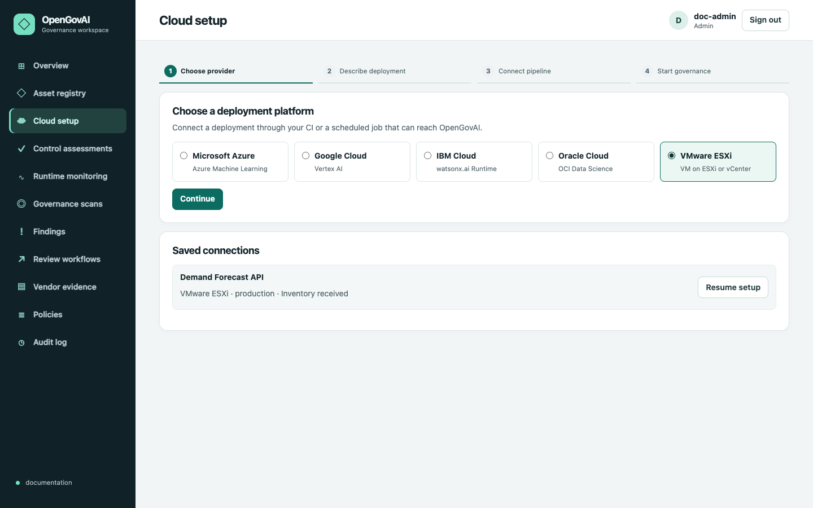

# OpenGovAI client deployment

This release includes deployment images for x86-64 and ARM64 Linux Docker
engines. Docker Desktop can run the release in Linux-container mode. Use a
local deployment terminal with Docker Engine and the Compose plugin available.

## Illustrated operator manuals

- [Administration](manuals/OpenGovAI-Administration.pdf) covers first sign-in,
  accounts, assets, reviews, scans, and recovery.
- [Configuration](manuals/OpenGovAI-Configuration.pdf) covers cloud and VMware
  setup, policy, monitoring, identity, and storage.
- [API](manuals/OpenGovAI-API.pdf) walks through readiness, inventory,
  evaluation, runtime observations, and release checks.

## Install and sign in

1. Extract the client archive to a directory you administer and open a terminal
   there. Run `./install.sh`. It checks the image archive and starts the
   prebuilt services using the Docker engine on this host.
2. Create an administrator and an independent reviewer in the same business unit:

   ```sh
   docker compose exec api opengovai manage create-user governance-admin --role admin --unit operations
   docker compose exec api opengovai manage create-user release-reviewer --role reviewer --unit operations
   ```

3. Open the printed dashboard URL and sign in. Use the [user manual](USER-GUIDE.md)
   for registration, assessments, findings, approvals, and scans. The dashboard
   defaults to `127.0.0.1:3000`. Change `PORT` in `.env` if required and run
   `docker compose up -d --wait`. For remote access, use a TLS ingress and enable
   `OPENGOVAI_SECURE_COOKIE=true` before opening access.

### Accounts and directory access

Use `opengovai manage` through the API container for local accounts, OIDC
provisioning, and credential management. Roles include `admin`, `contributor`,
`reviewer`, and `auditor`. A business unit scopes access to workspace records.
Run `docker compose exec api opengovai manage --help` for account and integration
commands. `disable-user USERNAME` revokes that account’s active sessions.

For OIDC, register `https://YOUR-HOST/api/v1/auth/oidc/callback` with your
identity provider and configure the OIDC settings in `.env`. Use authorization
code flow with S256 PKCE and a confidential client. Provision each user with
`opengovai manage provision-oidc USER --subject SUBJECT --role ROLE --unit UNIT`.
Confirm administrator SSO before disabling password login. Exclude callback
query strings from ingress logs.

For SCIM, configure the token, unit and non-admin role settings in `.env`.
Use `https://YOUR-HOST/api/v1/scim/v2` and map SCIM `externalId` to the stable
OIDC identifier. Verify creation and session revocation on suspension before
launch. Protect configuration and credentials as deployment secrets.

## Connect inventory

1. An administrator opens **Cloud setup** and selects Azure Machine Learning,
   Google Cloud Vertex AI, IBM Cloud watsonx.ai, Oracle Cloud Data Science, or
   VMware ESXi. Enter the identifier requested by the wizard, the deployed
   model, owning team, environment, and the immutable deployment reference.

   

2. Create the connection. Save the issued token as
   `OPENGOVAI_INTEGRATION_TOKEN`, and download `inventory.json`. For Azure,
   Google Cloud, IBM Cloud, and Oracle Cloud, use the wizard’s command from a
   pipeline that can reach the OpenGovAI URL over HTTPS.
3. For VMware, copy the inventory file to a runner with HTTPS access to ESXi or
   vCenter. Put the OpenGovAI URL, token, and VMware read-only credentials in a
   protected `vmware.env` file. Set `OPENGOVAI_URL`, `OPENGOVAI_VSPHERE_URL`,
   `OPENGOVAI_VSPHERE_USERNAME`, and `OPENGOVAI_VSPHERE_PASSWORD`. Set
   `OPENGOVAI_VSPHERE_CA_FILE` or `OPENGOVAI_CA_FILE` for private CAs and mount
   the corresponding files read-only at those paths inside the container.

   ```sh
   docker compose run --rm --no-deps --env-from-file vmware.env \
     -v "$PWD/inventory.json:/input/inventory.json:ro" \
     api opengovai vsphere-sync /input/inventory.json
   ```

4. In the wizard, choose **Verify connection**. After inventory is received,
   bind a release policy and proceed to the governance workflow. Schedule the
   runner before any inventory age limit. Increment the source revision and
   update the deployment reference when releasing a changed deployment.
5. **Rotate token** replaces the runner credential. Publish again and verify
   the new token. **Disable token** stops publishing and revokes the associated
   runtime gateway keys.

### AWS and other runners

Create an integration token with
`docker compose exec api opengovai manage create-integration registry-feed --unit operations`.
Supply the integration token and the HTTPS `OPENGOVAI_PUBLIC_URL` in the
runner’s protected environment file. Use
`docker compose run --rm --no-deps --env-from-file runner.env api opengovai COMMAND --help`
to view the parameters for the following commands:

| Command | Input |
| --- | --- |
| `aws-sync` | Read-only AWS identity, regions, owner, and environment. Discovers in-service SageMaker endpoints and Bedrock provisioned throughput. |
| `mlflow-sync` | Tracking URI and read-only authentication. Use rules to import measured results from registered model runs. |
| `prometheus-sync` | Prometheus connection and a mounted feed configuration containing deployment-specific PromQL and observation timestamps. |
| `release-check` | Asset ID, asset version, and deployment reference. Stop promotion on any nonzero exit. |

Pass files using read-only mounts and keep AWS and service credentials outside
the application’s files. Set `AWS_PROFILE` and mount credential configuration
read-only when using a named profile. Check a runner’s exit status and verify
its new data in OpenGovAI.

## Configure runtime monitoring and enforcement

1. Publish a control policy in **Policies**. Bind it in the asset’s **Release
   gate** or in the guided setup. Set evidence and inventory ages according to
   source refresh intervals. Require monitoring or dependencies when needed.
2. In **Runtime monitoring**, select **Configure monitor** for the active
   connected deployment and create a scalar or distribution rule. Send measured
   aggregate observations for that monitor ID and deployment reference. Include
   the actual observation timestamp and sample count or histogram.
3. Verify status and history using **Refresh signals** and **View history**.
   Review the incidents and the reassessments they open.
4. Use `release-check` from CI after updating inventory and evidence. For
   gateway enforcement, mint a separate, version-bound runtime key:

   ```sh
   docker compose exec api opengovai manage create-runtime-key production-gateway \
     --integration registry-feed --asset ASSET_ID --version 2 --deployment-ref BUILD_DIGEST
   ```

   Configure the trusted gateway to issue a GET authorization subrequest to
   `/api/v1/integrations/runtime-authorize` with the runtime key as a bearer
   token. Disable authorization response caching and omit the inference body
   and caller headers. Proceed only on HTTP 204. Keep existing client
   authentication and prevent direct access to the inference backend. Verify
   denial and API outage behavior before production use.

## Operate and recover

- Run `docker compose ps` and check `/api/v1/health` for readiness. To diagnose
  a service, use `docker compose logs --tail=100 api nginx`. Open the dashboard
  and use its sidebar to find the asset registry and governance scans.
- Keep `.env` and database backups under access control. The default SQLite
  database uses the Compose data volume. Schedule a cold backup with all
  writers stopped, and verify restoration in a disposable deployment. For
  PostgreSQL, configure `OPENGOVAI_DATABASE_URL` and use the
  `opengovai operations backup` and `verify-restore` commands with your
  PostgreSQL service credentials and restore test target.
- For audit retention, configure `OPENGOVAI_AUDIT_URL` and
  `OPENGOVAI_AUDIT_TOKEN`. Run `opengovai operations forward-audit DESTINATION`
  on a schedule and monitor its exit status. Use **Audit log** to inspect
  activity in the workspace.
- Before updating, verify a restorable backup. Preserve the Compose project
  name, its data volume, and the local `.env` when applying a new release.
  Run the new release’s installer and verify sign-in, a scan, and an evidence
  export. Use `docker compose stop` for maintenance.

Third-party notices for the web bundle are available at
`/third-party-licenses.md`. Runtime image package notices are retained in the
included image files.
