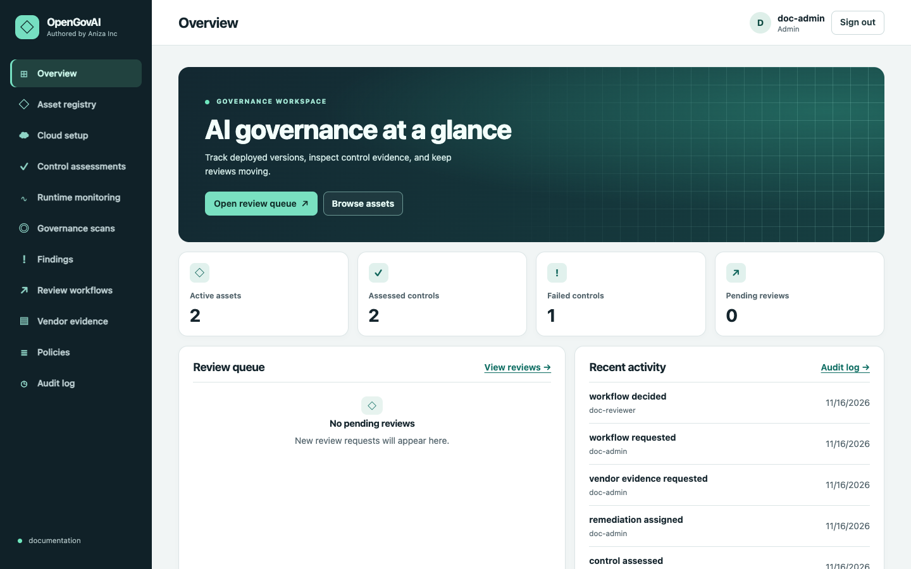

# OpenGovAI v5

**A self-hosted workspace for governing AI deployments from inventory through production.**

When a model changes, the people approving it need to know exactly what is being deployed, who owns it, which controls apply, what evidence supports the decision, and whether the release still meets policy. OpenGovAI brings those records into one workspace and ties them to a specific deployment version.

**Get started** with the [latest v5 client release](https://github.com/sjanizacorp/opengovai/releases/tag/v5.0.1), browse the [deployment files](v5/README.md), or download the illustrated [Administration](v5/manuals/OpenGovAI-Administration.pdf), [Configuration](v5/manuals/OpenGovAI-Configuration.pdf), and [API](v5/manuals/OpenGovAI-API.pdf) manuals.

## What you can do with v5

| Task | What OpenGovAI records or checks |
| --- | --- |
| Register AI deployments | Track owners, models, environments, immutable release references, and version history. Connect a feed to refresh inventory and register material changes. |
| Collect evidence | Record assessments, import measured evaluation results, request version-linked evidence from vendors, and retain the original source references. |
| Apply release policy | Choose required controls, evidence and inventory age limits, dependency requirements, monitoring requirements, and approval stages. Bind the policy to the deployment. |
| Review and approve | Route decisions to eligible reviewers. Retain the approved version, policy, evidence snapshot, and decision digest together. |
| Check and monitor production | Run a governance scan, check the release from CI, or have a trusted gateway check the approved deployment before forwarding inference requests. |
| Remediate and investigate | Assign findings, record retests, review stale or breached runtime observations, and track reassessment when required. |

## How a deployment moves through the workspace

1. **Register it.** Enter the deployment manually or connect it to a pipeline. Keep a stable asset identity and record an immutable release reference for each material version.
2. **Bind the required policy.** Define the controls, freshness limits, and review stages for that deployment. Where needed, record the exact upstream versions of models, datasets, services, or tools.
3. **Collect and review evidence.** Record assessments, import evaluation results, or request vendor evidence. A separate eligible reviewer inspects the evidence and records the decision.
4. **Check the release.** Run a governance scan in the workspace. In automated delivery, call the release gate immediately before promotion and use the returned result to allow or stop the job.
5. **Continue monitoring.** Send aggregate observations tied to the deployment version. Investigate incidents and complete any required reassessment when a signal becomes stale or breaches a threshold.

A material deployment change creates a new version. Historical evidence and approval receipts stay with the version they covered, so operators can inspect what was approved and when.

## Deployment environments

- **AWS.** The included read-only runner discovers in-service SageMaker endpoints and Bedrock provisioned throughput deployments in the configured regions.
- **Microsoft Azure, Google Cloud, IBM Cloud, and Oracle Cloud.** The guided setup walks an administrator through identifying a deployment, issuing a scoped credential, publishing inventory through CI or a scheduled job, and verifying receipt in the workspace.
- **VMware ESXi and vCenter.** A read-only runner finds the selected VM by BIOS UUID and refreshes inventory while that VM is connected and powered on. The application pipeline supplies the model and release reference.
- **Existing tools and custom pipelines.** MLflow can provide registry inventory and measured evaluation evidence. Prometheus can supply aggregate runtime observations. A versioned API supports custom publishers and release checks.

## Built for the people involved in a release

Platform operators configure deployments, access, telemetry, and backups. Model owners register versions and request review. Reviewers assess evidence and make decisions. Auditors can inspect records and export available evidence within their business unit. OpenGovAI supports local accounts, OIDC single sign-on, SCIM provisioning, and unit-scoped access.

## Install the client and try a staging release

1. Download the [offline v5.0.1 client archive](https://github.com/sjanizacorp/opengovai/releases/download/v5.0.1/opengovai-5.0.1-client.tar.gz). It includes prebuilt images for x86-64 and ARM64 Docker engines.
2. Extract the archive and run `./install.sh` with Docker and Docker Compose available.
3. Follow the [Administration Manual](v5/manuals/OpenGovAI-Administration.pdf) to create an administrator and a separate reviewer in the same unit.
4. Register a staging deployment and complete one cycle from inventory and policy through evidence, approval, and a governance scan. Use the [Configuration Manual](v5/manuals/OpenGovAI-Configuration.pdf) for provider setup and the [API Manual](v5/manuals/OpenGovAI-API.pdf) for integration examples.

The three manuals include screenshots from the workspace, guided procedures, expected results, and troubleshooting. Start with Administration for account and daily workflow tasks, Configuration for setup and operator handoffs, and API for feed and release integrations.
