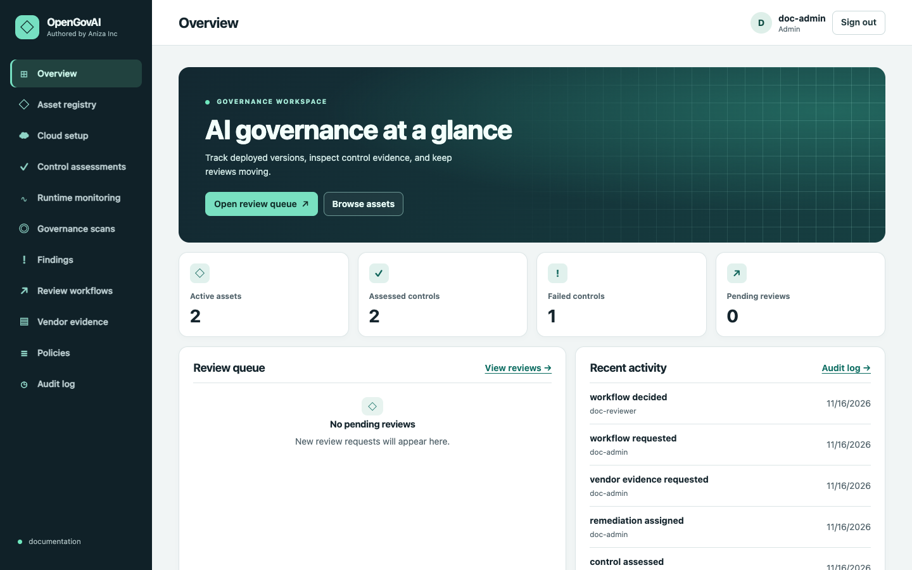
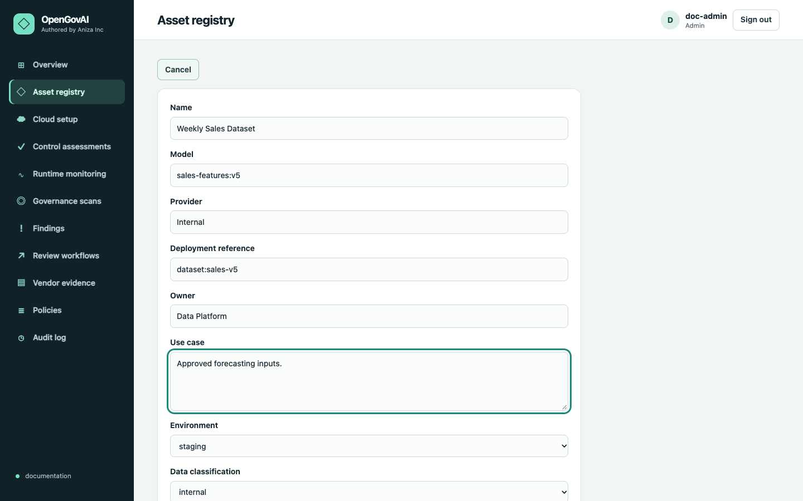
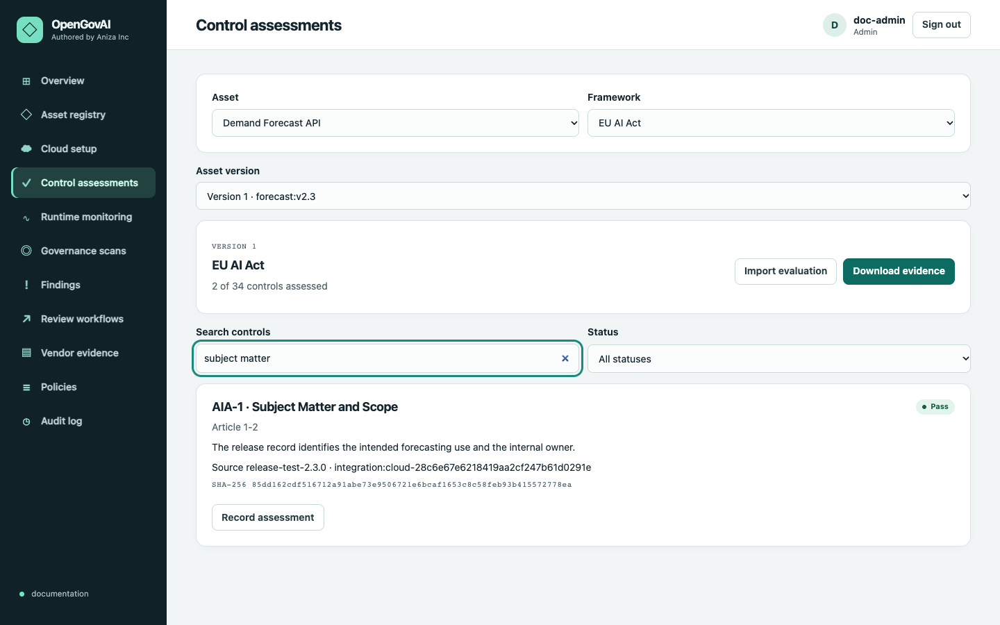
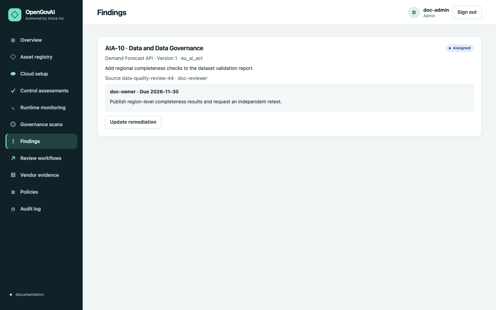
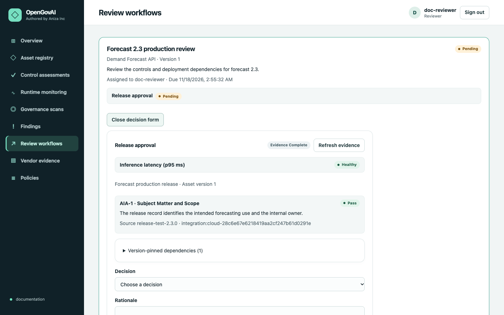
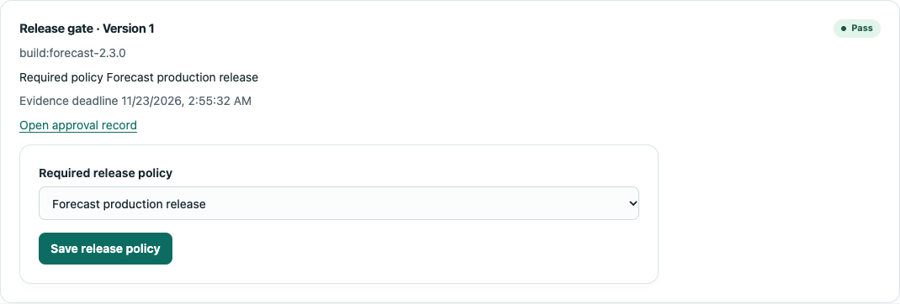
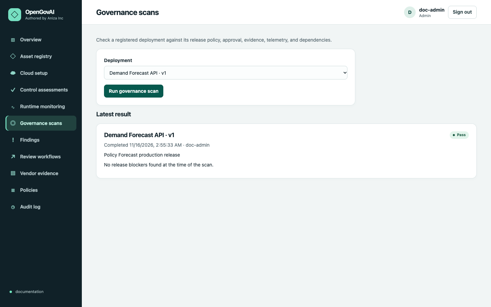
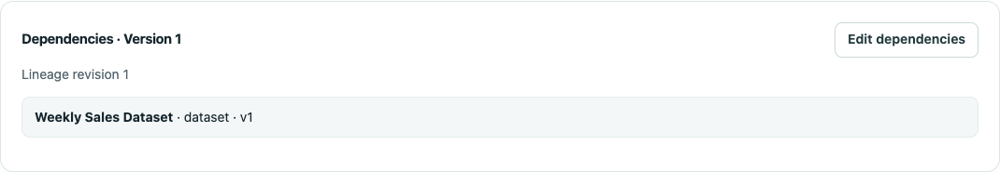
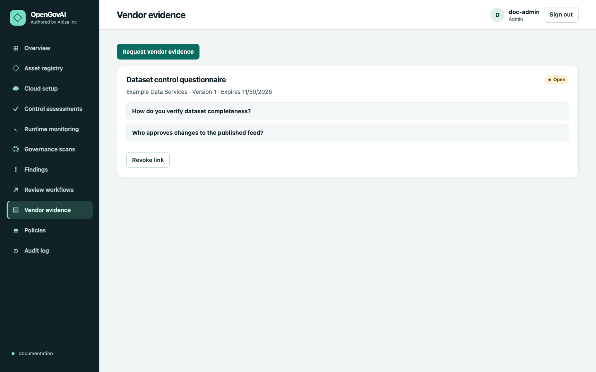
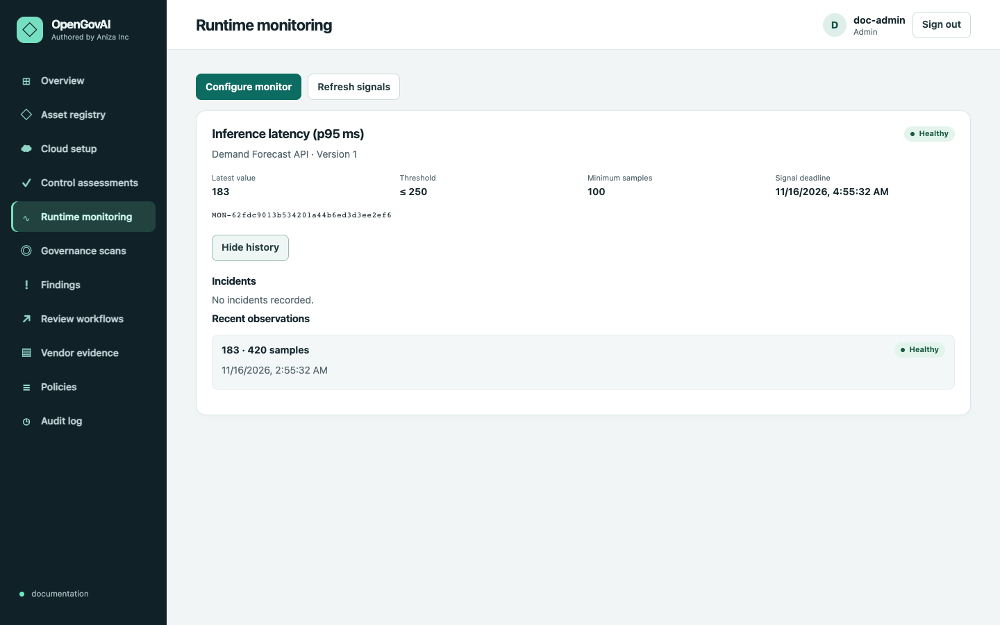

# OpenGovAI user manual

**OpenGovAI is authored by Aniza Inc.**

- [Sign in and find your work](#sign-in-and-find-your-work)
- [Register and version an asset](#register-and-version-an-asset)
- [Assess controls and resolve findings](#assess-controls-and-resolve-findings)
- [Request, decide, and export a review](#request-decide-and-export-a-review)
- [Check a release and run a governance scan](#check-a-release-and-run-a-governance-scan)
- [Track upstream dependencies](#track-upstream-dependencies)
- [Request vendor evidence](#request-vendor-evidence)
- [Investigate runtime signals](#investigate-runtime-signals)

See the [administrator manual](CLIENT-GUIDE.md) for installation, cloud and VMware setup, user accounts, and production operations. Screenshots use fictional workspace records.

## Sign in and find your work

1. Open the URL provided by your administrator. Choose company sign-in if your organization uses SSO, or enter your local username and password.
2. Check your role in the top bar and your business unit at the bottom of the sidebar. If an asset you expect is missing, ask its owner to confirm the unit and asset name.
3. Open **Overview**. Use the asset inventory, review queue, and findings summaries to locate work. Use the sidebar to open the corresponding screen.



| Role | Typical work |
| --- | --- |
| Contributor | Register assets, publish manual asset versions, request reviews, and run scans |
| Reviewer | Record control assessments, decide eligible reviews, run scans, and request vendor evidence |
| Administrator | Configure policies, connected inventory, dependencies, monitors, and remediation assignments, and perform eligible governance actions |
| Auditor | Read workspace records, view the audit log, and download available evidence |

## Register and version an asset

1. Open **Asset registry → Register asset**. Enter a display name, model, provider, and owner.
2. Choose the environment, data classification, and autonomy level. Describe the intended use and enter an immutable deployment reference, such as an image digest or build ID, if the asset will be release-gated.
3. Submit **Register asset**. The record opens at version 1.
4. For a material change to a manually registered asset, choose **Publish new version**. Enter the new model, deployment reference, and a short change summary, then select **Publish version**. Use **Version history** to inspect earlier releases.
5. For a connected deployment, update it through its inventory feed. The connector retains the asset ID and creates a version when material metadata changes. Version changes supersede pending reviews for the older version. Historical evidence stays attached to that version.
6. To retire a deployment, an administrator selects **Archive** and confirms. The archived asset remains available for historical evidence.



For automated inventory, ask an administrator to use [guided deployment setup](CLIENT-GUIDE.md#connect-inventory).

## Assess controls and resolve findings

1. Open **Control assessments** and select the asset, asset version, and framework. Review and assessment work uses the active version. Earlier versions remain available for historical inspection and export.
2. Filter by control ID, control name, or status. On the selected control, choose **Record assessment**.
3. Select **Pass**, **Fail**, or **Not applicable**, supply a source reference, and write the evidence and rationale. Use references to controlled documents for sensitive or large evidence. Select **Save assessment**.
4. For a batch, choose **Import evaluation**, enter the run reference, pick a JSON file, and select **Import results**. The UI accepts a JSON array of up to 30 results and a file up to 100 KB. Use one result per control. If a policy sets a maximum evidence age, provide the time-zone-aware observation timestamp for imported passing evidence.
5. To export the selected version’s evidence, choose **Download evidence**. The export includes assessment history and related records for that version.



Example evaluation file. Replace the evidence and timestamp with the actual observation:

```json
[
  {
    "control_id": "AIA-1",
    "outcome": "pass",
    "evidence": "Intended use and deployment scope verified in the release record.",
    "observed_at": "2026-01-15T14:00:00Z"
  }
]
```

### Remediate a failed control

1. Open **Findings** and confirm the asset version, failed control, evidence, and source.
2. An administrator or reviewer opens the assignment action, supplies an account username from the same unit, chooses a due date, and enters a remediation plan.
3. The assignee completes the remediation. An eligible assessor records a retest on the same asset version and control. A passing retest clears the finding.
4. If the control regressed after release approval, request a new review. The release gate may still require reassessment after the finding clears.



## Request, decide, and export a review

1. In **Review workflows**, choose **Request review**, select the current asset version and the relevant control policy, then enter a type, title, and description. Select **Submit review request**.
2. As an eligible reviewer, find the pending stage and choose **Inspect evidence and decide**. Review its policy, controls, sources, and any relevant dependencies, vendor responses, and monitoring state.
3. If the evidence is incomplete, resolve the listed blockers and select **Refresh evidence**. A reviewer can reject an incomplete request with a rationale. An approver must be a different account from the requester. Follow the configured stage order and assigned reviewer.
4. Select a decision, enter the rationale, and choose **Record decision**. If the evidence changed while you were reading it, refresh the evidence and review the new snapshot before deciding.
5. For an approved stage, choose **Download approved evidence**. The record contains the decision and an immutable evidence snapshot with its digest. Keep it with the release record. Follow the due date shown on the current stage. An administrator can decide an overdue assigned stage if a different account requested the review.



## Check a release and run a governance scan

1. Open **Asset registry** and expand **Release gate** for the deployment. Confirm the version and deployment reference match the release candidate.
2. An administrator chooses the required release policy and selects **Save release policy**. An existing policy can also be bound from a verified guided setup.
3. Read the gate result. Common blockers include a missing review, failed or expired evidence, stale inventory, an unhealthy monitor, and a changed dependency. Correct the listed condition and complete a new review when the gate requires one.
4. Choose **Run checks** on the asset, or go to **Governance scans** and select the deployment. Click **Run governance scan**. Inspect **Latest result** and compare it with **Scan history**. The scan evaluates the current governance records for the selected version.
5. If a scan seems to do nothing, confirm that the selected asset is active and your role can run scans, then check for a displayed error or a new entry in **Scan history**. For API or deployment issues, use the [administrator troubleshooting table](CLIENT-GUIDE.md#operate-and-recover).





## Track upstream dependencies

1. Register each upstream model, dataset, service, or tool as an asset in the same unit.
2. An administrator opens **Asset registry → Dependencies → Edit dependencies** for the consuming asset. Choose **Add upstream asset**.
3. Select the upstream asset and dependency type. Verify its pinned version, then select **Save dependencies**.
4. Check the resulting lineage revision, transitive dependencies, and downstream consumers. If an upstream version changes, inspect the impact and use **Use current version** to update the pin when appropriate. Refresh the release review when the gate reports a dependency change.



## Request vendor evidence

1. An administrator or reviewer opens **Vendor evidence → Request vendor evidence**.
2. Select the asset version. Enter the vendor, questionnaire title, one question per line, and the expiry in days. Select **Create private questionnaire**.
3. Copy the private link when it is displayed and send it through an approved channel. The link allows one submission. The vendor enters contact information and answers each question.
4. Return to **Vendor evidence** to inspect the submitted response or revoke an unused link. The relationship to an asset version is preserved in evidence exports and applicable review snapshots.



## Investigate runtime signals

1. Open **Runtime monitoring** and verify the monitor belongs to the correct deployment and version. Review the threshold, latest value, minimum sample count, and signal deadline.
2. Choose **Refresh signals** to reload the page data. Choose **View history** to see received observations and incidents.
3. For overdue or insufficient observations, check the source job and its aggregate window. For threshold breaches, inspect the metric and mitigate the underlying issue.
4. Open the incident’s **reassessment** link and complete the requested review. A fresh passing observation can recover the incident. If reassessment is still required, complete it before attempting release.
5. Administrators can configure the monitor and feed through the [runtime setup instructions](CLIENT-GUIDE.md#configure-runtime-monitoring-and-enforcement).


