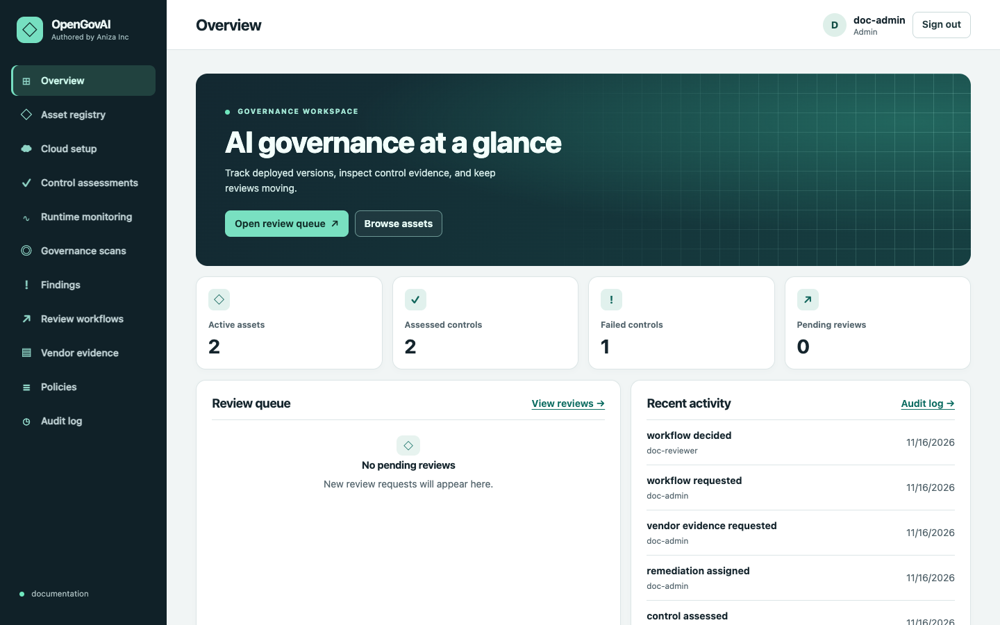
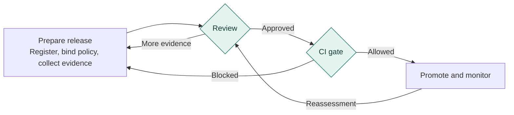
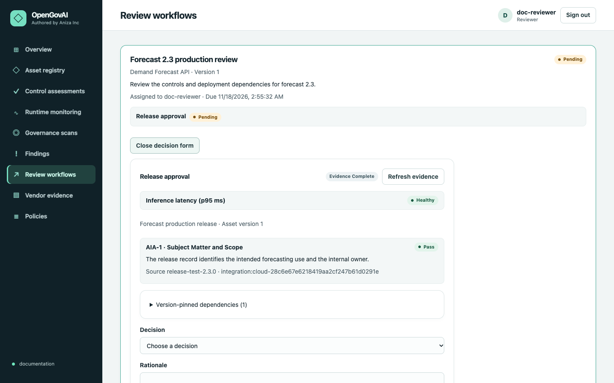
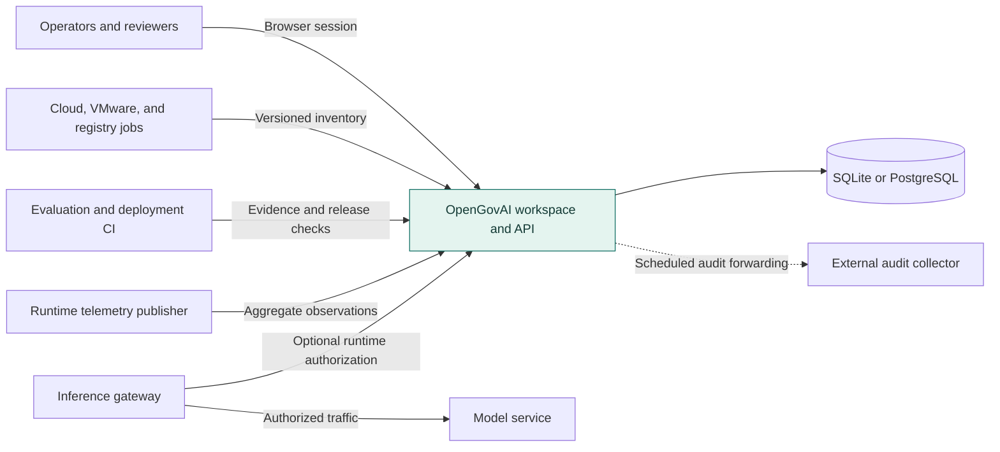
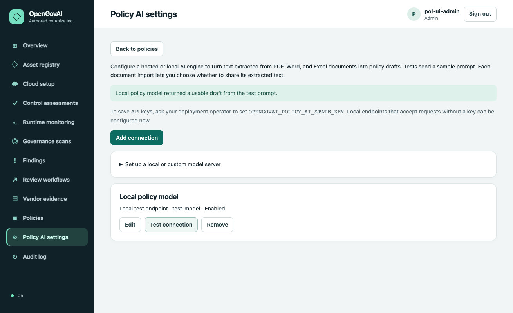
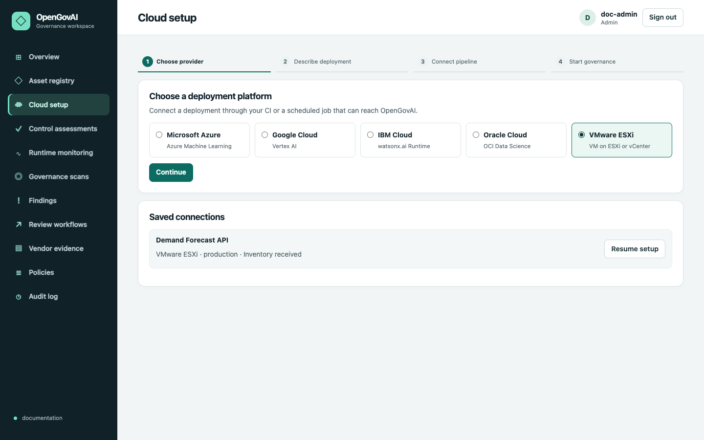
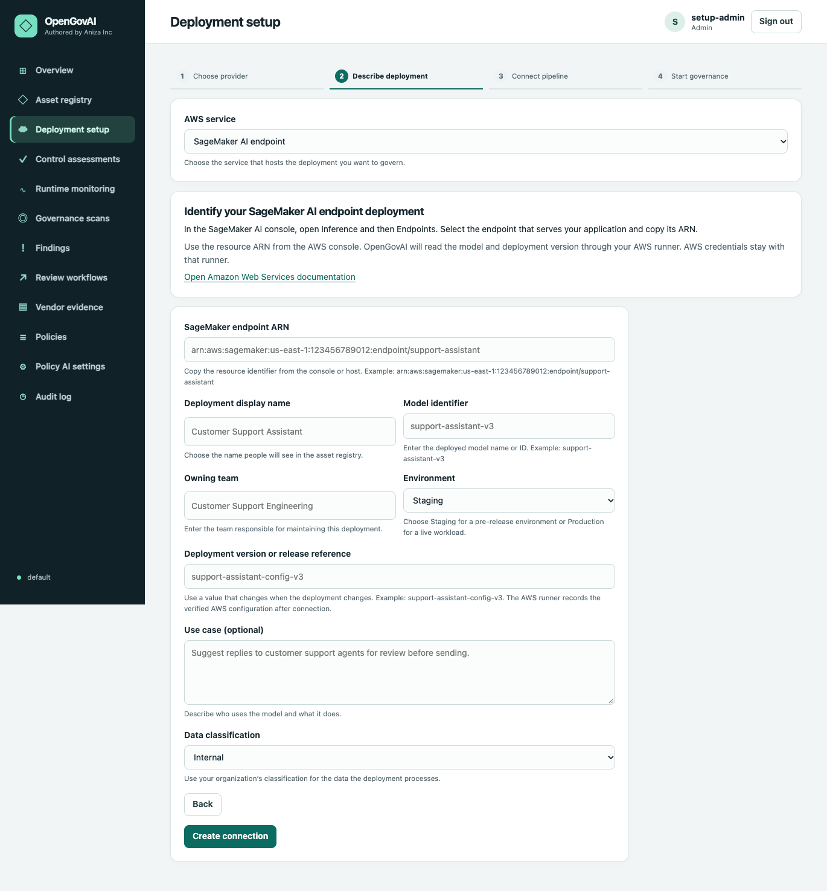

# OpenGovAI v5 client deployment

**Self-hosted AI deployment governance, authored by Aniza Inc.**

OpenGovAI helps organizations decide whether an AI deployment is ready for release and whether it still meets policy after launch. It ties the decision to an exact deployment version, the controls and evidence that apply to it, the people who approved it, and the runtime conditions they rely on. When something changes, operators can identify which release is affected, why it is blocked, and what needs to be reviewed again.

[Download the current client release](https://github.com/sjanizacorp/opengovai/releases/tag/v5.1.3) · [Install and operate](#quick-start) · [Administration PDF](manuals/OpenGovAI-Administration.pdf) · [Configuration PDF](manuals/OpenGovAI-Configuration.pdf) · [API PDF](manuals/OpenGovAI-API.pdf)



## Contents

[Release workflow](#release-workflow) · [Architecture](#deployment-architecture) · [Governance catalogs](#governance-catalogs) · [Policy import and model setup](#policy-import-and-model-setup) · [AWS setup](#connect-an-aws-deployment) · [Local model governance](#govern-a-local-model) · [Integrations](#integrations) · [API and enforcement](#api-and-enforcement) · [Access and operations](#access-and-operations) · [Quick start](#quick-start)

## Release workflow



A forecasting model moves from build 2.3 to 2.4. The delivery team registers 2.4 with its release reference and pins the dataset version it depends on. The evaluation job submits measured results for 2.4. A reviewer inspects the applicable controls and records a decision. CI then checks 2.4 before promotion. The approval receipt for 2.3 stays available for audit.

After launch, the platform team monitors an aggregate signal such as p95 latency. A breach, stale report, or insufficient sample count can open an incident and require reassessment. If a required control failed after approval, a passing retest can clear the finding while a new review is still required for release.

### What the workspace tracks

| Record | What it answers |
| --- | --- |
| **Asset and deployment version** | Who owns it, what it does, which model and environment it uses, and which build or digest is under review. Material inventory changes create a version. |
| **Policy and control catalog** | Which controls must pass, which evidence or inventory age limits apply, and whether lineage and runtime monitoring are required. |
| **Assessment and evaluation** | Which control was tested, by whom or by which job, with what outcome and evidence, and when it was observed. Evidence reuse across catalogs is limited to reviewed mappings and the same deployment version. |
| **Dependency graph** | Which upstream model, dataset, service, or tool versions this release consumes. Changed upstream versions can block release until reviewed. |
| **Workflow and decision receipt** | Who reviewed each stage, the rationale, and the evidence snapshot with its SHA-256 digest. Stages can have assigned reviewers and deadlines. |
| **Scan, finding, or incident** | Which condition blocked release or breached a monitor, who is assigned to resolve it, and whether another review is needed. |
| **Vendor evidence and audit** | Which version received an external response, which actor performed an action, and when it occurred. Vendor questionnaires use an expiring, single-use link. |

<details>
<summary>See the reviewer’s evidence panel</summary>



</details>

## Deployment architecture



- **Workspace and API.** The Compose deployment serves the browser UI and versioned API through a loopback reverse proxy by default. Put approved HTTPS ingress in front for remote use.
- **Storage.** Start with the persistent SQLite volume, or configure PostgreSQL for your deployment. Preserve the data store across upgrades and test restores in a separate environment.
- **Publishers.** Inventory, evaluation, and telemetry jobs publish deployment data through scoped credentials. Those jobs connect to their respective cloud services, registries, or monitoring sources.
- **Enforcement.** CI can stop a promotion on a failed release check. An optional inference gateway can check the recorded governance state before forwarding a request. The authorization subrequest carries its own runtime key and omits the inference payload.

## Governance catalogs

OpenGovAI provides versioned assessment catalogs. A policy selects a framework and the controls relevant to a deployment. An organization determines which requirements apply and how to assess them.

| Catalog | Assessment focus |
| --- | --- |
| **EU AI Act** | AI system scope, risk classification, and applicable obligations |
| **NIST AI Risk Management Framework** | Governance, mapping, measurement, and management of AI risk |
| **ISO/IEC 42001:2023** | AI management system responsibilities and controls |
| **OWASP Top 10 for LLM Applications (2025)** | Application security risks specific to LLM systems |
| **21 CFR Part 11** | Electronic record and signature controls relevant to FDA-regulated settings |
| **NIST AI 600-1** | Generative AI risks, including confabulation, bias, privacy, security, and upstream components |
| **ISO/IEC 23894:2023** | AI risk identification, treatment, acceptance, and monitoring |
| **ISO/IEC 42005:2025** | Assessment of impacts on people, groups, and deployment contexts |
| **ISO/IEC 38507:2022** | Governing-body oversight, accountability, and escalation |
| **OECD Due Diligence Guidance for Responsible AI (2026)** | Identification, prevention, tracking, communication, and remediation of adverse impacts |

## Policy import and model setup

1. Sign in as a workspace administrator and open **Policies → Import document**. Choose a text-based PDF, Word `.docx`, or Excel `.xlsx` up to 5 MB. Use **Download Excel template** to start from a structured policy workbook. Apply OCR separately to scanned PDFs.
2. To use an LLM, open **Policies → Policy AI settings → Add connection**. Choose a built-in OpenAI or Google Gemini endpoint, or an OpenAI-compatible server approved by the deployment operator, such as Ollama or LM Studio. Enter the model ID and its API key if required, then select **Save connection → Test connection**. The test sends a synthetic policy prompt.
3. Return to **Import document**, select the framework and your connection, and authorize sharing the extracted text. Compare the proposed name, policy text, and controls to the source before publishing. Local text extraction is the default. Structured Excel templates are parsed locally.

The API sends extracted text and the selected framework's controls to the chosen model. The deployment operator can register local or custom endpoints with `OPENGOVAI_POLICY_AI_ENDPOINTS`, enable encrypted credential storage with `OPENGOVAI_POLICY_AI_STATE_KEY`, and disable the built-in public presets with `OPENGOVAI_POLICY_AI_ALLOW_PUBLIC=false`. Follow the [client setup guide](CLIENT-GUIDE.md#connect-a-local-or-hosted-language-model) for Docker networking, credentials, and restart steps.

<details>
<summary>See a configured local model</summary>



</details>

The installer can also set up and test an existing keyless Ollama, LM Studio, or compatible server. A passing connection appears as **Local policy model** in the import picker.

## Integrations

| Environment or tool | Connection method | What to supply |
| --- | --- | --- |
| **AWS** | Read-only inventory runner for active SageMaker endpoints and Bedrock provisioned throughput deployments. | AWS workload credentials, regions, and the OpenGovAI integration token. |
| **Microsoft Azure** | Guided setup for Azure Machine Learning online deployments. Your job supplies deployed metadata. | Online deployment resource ID, model version, release reference, and the scoped token. |
| **Google Cloud** | Guided setup for Vertex AI endpoints. Your job supplies deployed metadata. | Endpoint resource name, deployed model ID, release reference, and the scoped token. |
| **IBM Cloud** | Guided setup for watsonx.ai Runtime. Your job supplies deployed metadata. | Deployment space and deployment ID, release reference, and the scoped token. |
| **Oracle Cloud** | Guided setup for OCI Data Science model deployments. Your job supplies deployed metadata. | Model deployment OCID, release reference, and the scoped token. |
| **Local model server** | Verify installed model inventory over Ollama or OpenAI-compatible APIs. | Model ID, local server URL, deployment reference or digest, and the scoped token. |
| **VMware ESXi and vCenter** | Read-only VM lookup using its BIOS UUID. Inventory refreshes when one matching VM is visible, connected, and powered on. | VM BIOS UUID, read-only VMware access, and the application’s model and release reference. |
| **MLflow** | Scheduled registry discovery and optional evaluation import from run metrics. | Tracking URI, read-only credentials, and evaluation rules if applicable. |
| **Prometheus** | Scheduled read of aggregate runtime observations. | Prometheus endpoint, configured monitor, deployment reference, and queries for the measurement and observation time. |
| **Custom CI or registry** | Use the versioned API to publish inventory, evaluations, and telemetry, then check release readiness. | Stable external ID, increasing source revision, scoped token, and the deployment reference. |

<details>
<summary>See the guided deployment wizard</summary>



</details>

## Connect an AWS deployment

In **Deployment setup**, choose **Amazon Web Services**, then select
**SageMaker AI endpoint** or **Bedrock Provisioned Throughput**. The
wizard shows a full ARN example and instructions for locating it, along
with examples for the model, team, and deployment version.

Create the connection, download `inventory.json`, and run the scoped AWS
connector with a read-only profile or workload role. It reads the model and
deployment configuration from the configured AWS resource before publishing.
The wizard shows the native or Docker command and the permissions needed.
See the [AWS setup steps](CLIENT-GUIDE.md#connect-an-aws-deployment).

<details>
<summary>See the SageMaker setup form</summary>



</details>

## Govern a local model

Choose **Deployment setup → Local language model**. Enter the model ID,
download the inventory manifest, and run the local-model connector from a
host with access to the model API. The connector checks the model list.
For Ollama, it also captures the model digest and versions the asset when
that digest changes. For LM Studio and other compatible servers, supply
the immutable deployment reference and advance the source revision when
the deployment changes.

Bind a policy after verifying the connection and open **Governance scans**.
Local deployments use the same version-specific controls, evidence,
reviews, release decisions, and runtime rules as cloud deployments.
See the [native client guide](NATIVE-GUIDE.md#govern-a-local-model-deployment)
for the runner command and settings.

## API and enforcement

### From inventory to promotion

1. **Publish inventory.** Send a stable `external_id`, a `source_revision`, and an immutable `deployment_ref`. Save the returned `asset_id` and `asset_version`. An identical accepted replay refreshes inventory. A conflicting payload at the same revision is rejected.
2. **Publish evidence.** Send measured outcomes for the applicable control IDs, with the source run and observation time. Evidence is version-specific. An independent approval records the evidence and policy used for the decision.
3. **Check the deployment.** Call the release gate with the exact `asset_id`, `asset_version`, and `deployment_ref`. Promote only after a passing response. Correlate the review ID and receipt digest with your release record.
4. **Monitor the result.** Publish windowed aggregate observations using the monitor ID and deployment reference. Include a stable event ID, observation time, and either a scalar value with sample count or a matching histogram.

| Endpoint | Credential | Outcome |
| --- | --- | --- |
| `GET /api/v1/health` | None | `200` when the API can access storage, `503` when readiness fails |
| `POST /api/v1/integrations/assets/sync` | Integration bearer token | Asset ID, registered version, and accepted source revision |
| `POST /api/v1/integrations/evaluations` | Owning integration token | Evaluation receipt with result count and duplicate status |
| `POST /api/v1/integrations/runtime-observations` | Owning integration token | Recorded observation and evaluated monitor status |
| `POST /api/v1/integrations/release-gate` | Owning integration token | `200` for an approved release or `409` with governance blockers |
| `GET /api/v1/assets/{asset_id}/release-status` | Authorized workspace session | Current release status and blocker details |
| `POST /api/v1/scans` | Eligible workspace session | `201` and a stored governance scan for the selected version |
| `GET /api/v1/integrations/runtime-authorize` | Version-bound runtime key | `204` allows forwarding, `403` blocks the deployment, and `401` indicates an invalid key |

See the [API Manual](manuals/OpenGovAI-API.pdf) for request examples, credentials, and expected responses.

### What can stop a release

- **Deployment identity or policy changed.** A different version, reference, or bound policy requires evidence and approval for that release.
- **Evidence is missing, failing, or stale.** The gate checks required controls and the configured age limits. A post-approval control regression can require a new review.
- **Lineage or runtime conditions changed.** A pinned dependency can become unavailable or move versions. Required or configured monitors can block on missing, stale, insufficient, or breached signals.
- **Approval is incomplete.** The gate checks for a completed approval and an intact evidence receipt for the current version and policy.

For gateway enforcement, verify in staging that approved requests can reach the model and that denied authorization or an unavailable authorizer blocks forwarding. Keep client authentication on the inference route and restrict direct access to the model service. See the [client deployment guide](CLIENT-GUIDE.md#configure-runtime-monitoring-and-enforcement).

## Access and operations

| Role | Typical responsibilities |
| --- | --- |
| **Administrator** | Set policy, configure connections and monitors, manage privileged workspace actions, and inspect audit activity. |
| **Contributor** | Register assets, publish manual versions, request reviews, and run governance scans. |
| **Reviewer** | Record assessments, review eligible requests, assign remediation, and request vendor evidence. |
| **Auditor** | Read authorized workspace records and export evidence or review audit activity. |

Accounts and integration tokens are assigned to business units. Browser sessions can use local accounts or OIDC single sign-on. Optional SCIM provisioning supports user lifecycle management. An eligible reviewer must be a different account from the requester to approve a stage. Use distinct credentials for machine publishers, runtime authorization, and operational integrations.

For production, verify HTTPS ingress, role and unit isolation, readiness checks, credential rotation, audit delivery, and a database restore before opening access. Run a representative staging release from registration to gate decision, then exercise an expired signal or failed control so operators can see how reassessment works. See the [Administration](manuals/OpenGovAI-Administration.pdf) and [Configuration](manuals/OpenGovAI-Configuration.pdf) manuals.

## Quick start

### Native install

Setup creates an isolated `.venv`. It reuses compatible CPython 3.12 or
downloads a checksum-verified runtime into the installation folder.
First install needs access to the runtime download and a Python package
index. Linux requires glibc 2.36 or later.

| System | Apple Silicon or ARM64 | Intel or x86-64 |
| --- | --- | --- |
| macOS | [Apple Silicon (M-series)](https://github.com/sjanizacorp/opengovai/releases/download/v5.1.3/opengovai-5.1.3-native-macos-apple-silicon-arm64.tar.gz) | [Intel](https://github.com/sjanizacorp/opengovai/releases/download/v5.1.3/opengovai-5.1.3-native-macos-intel-x86-64.tar.gz) |
| Linux | [ARM64](https://github.com/sjanizacorp/opengovai/releases/download/v5.1.3/opengovai-5.1.3-native-linux-arm64.tar.gz) | [x86-64](https://github.com/sjanizacorp/opengovai/releases/download/v5.1.3/opengovai-5.1.3-native-linux-x86-64.tar.gz) |

Download the [standalone native installer](https://github.com/sjanizacorp/opengovai/releases/download/v5.1.3/install-native.sh)
and run `bash install-native.sh`. It detects macOS or the Linux distribution
and CPU, selects the matching package, and verifies its checksum. Every
native archive also includes `install-native.sh` beside `install.sh`.
Choose the installation folder at the prompt or pass it explicitly.

```sh
bash install-native.sh --install-dir "$HOME/Applications/OpenGovAI"
```

Setup prints the
dashboard address and writes `setup.log`. Use `./start.sh`, `./stop.sh`,
and `./uninstall.sh` to manage the installation. See the
[native client guide](NATIVE-GUIDE.md).

### Docker install

The current Docker client is [v5.1.3](https://github.com/sjanizacorp/opengovai/releases/tag/v5.1.3).
Start Docker with a Linux engine. Use Bash on macOS, Linux, or Windows with WSL and Docker integration.

| Docker engine architecture | One offline client download |
| --- | --- |
| x86-64 | [Download x86-64](https://github.com/sjanizacorp/opengovai/releases/download/v5.1.3/opengovai-5.1.3-client-amd64.tar.gz) |
| ARM64 | [Download ARM64](https://github.com/sjanizacorp/opengovai/releases/download/v5.1.3/opengovai-5.1.3-client-arm64.tar.gz) |

1. Extract the download and run `./install.sh`. Choose the installation folder at the prompt, or pass `--install-dir DIR`. From the expanded v5 deployment directory, run `./install.sh --download` to detect the Docker engine and fetch its bundle automatically.
2. Choose the dashboard port and optionally connect a running Ollama, LM Studio, or compatible local model server. Provide the model ID and base URL. Setup tests the connection with a sample policy.
3. Create the initial administrator. A username can be one character and the minimum password length is 12 characters. Open the printed dashboard URL, typically `http://127.0.0.1:3000`.
4. Check `setup.log` for installation progress, the dashboard and API addresses, configuration paths, and operational commands. Existing administrators and settings are preserved when rerunning setup.

The compact downloads contain one platform image, the installer and runtime configuration, and the three PDF manuals. The [deployment guide](CLIENT-GUIDE.md#install-and-sign-in) includes unattended setup and upgrade instructions.

| Manual | Start here when you need to… |
| --- | --- |
| [Administration PDF](manuals/OpenGovAI-Administration.pdf) | Install, manage access, run day-to-day work, or troubleshoot and recover |
| [Configuration PDF](manuals/OpenGovAI-Configuration.pdf) | Connect cloud or VMware inventory, set up policy AI, configure telemetry, or set up identity and storage |
| [API PDF](manuals/OpenGovAI-API.pdf) | Check readiness, publish inventory or evidence, or enforce release checks in CI |
| [Workspace user guide](USER-GUIDE.md) | Get a task-by-task walkthrough in Markdown |
